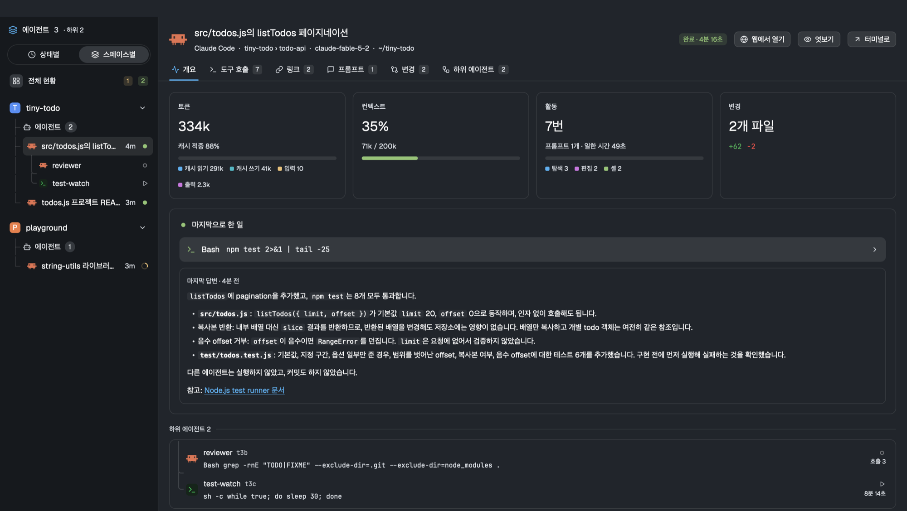
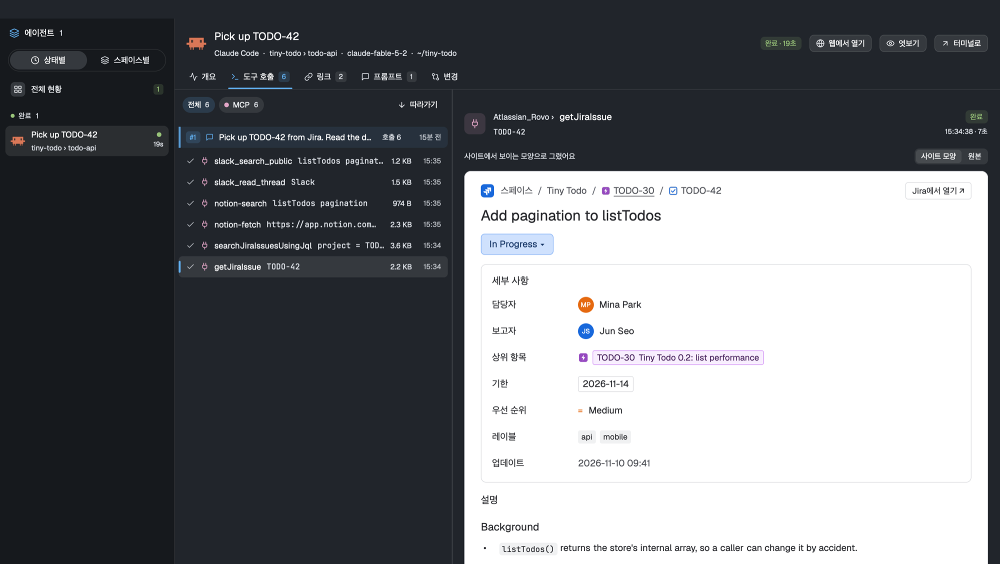
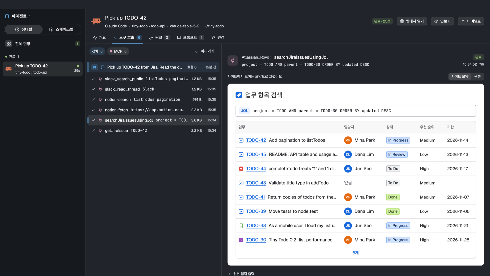
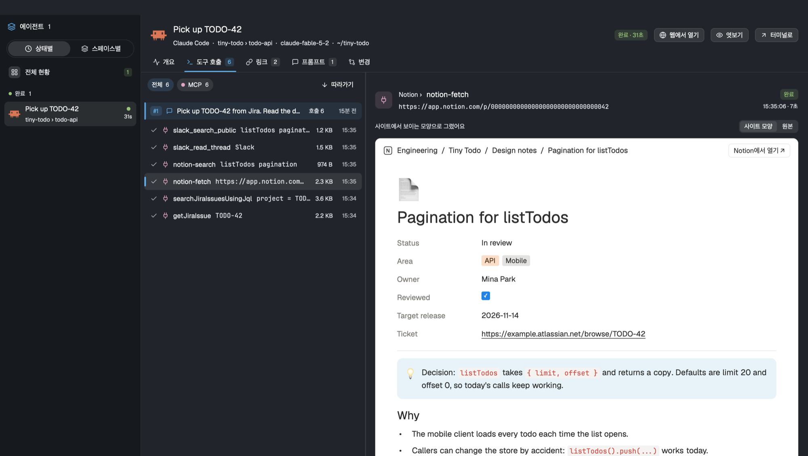
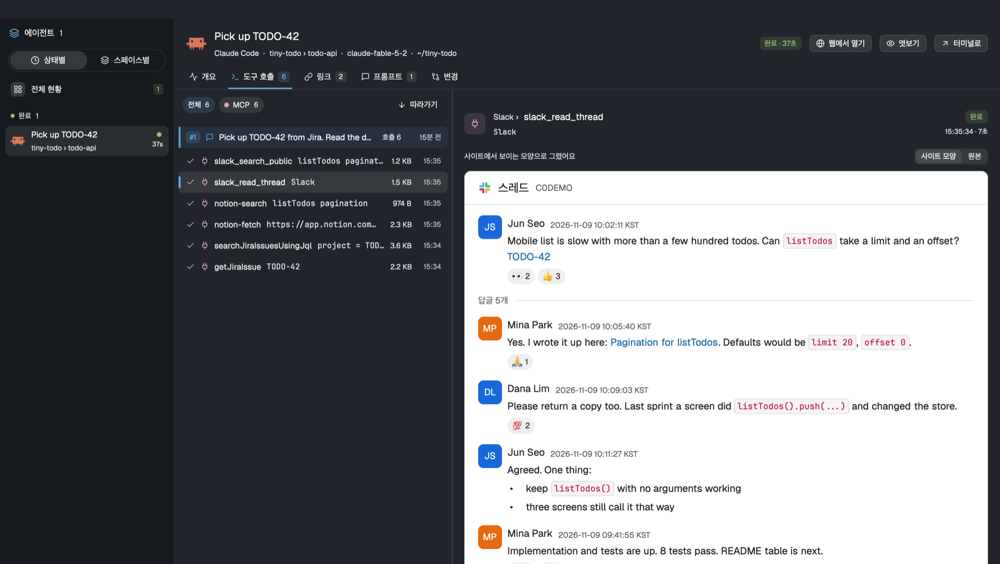
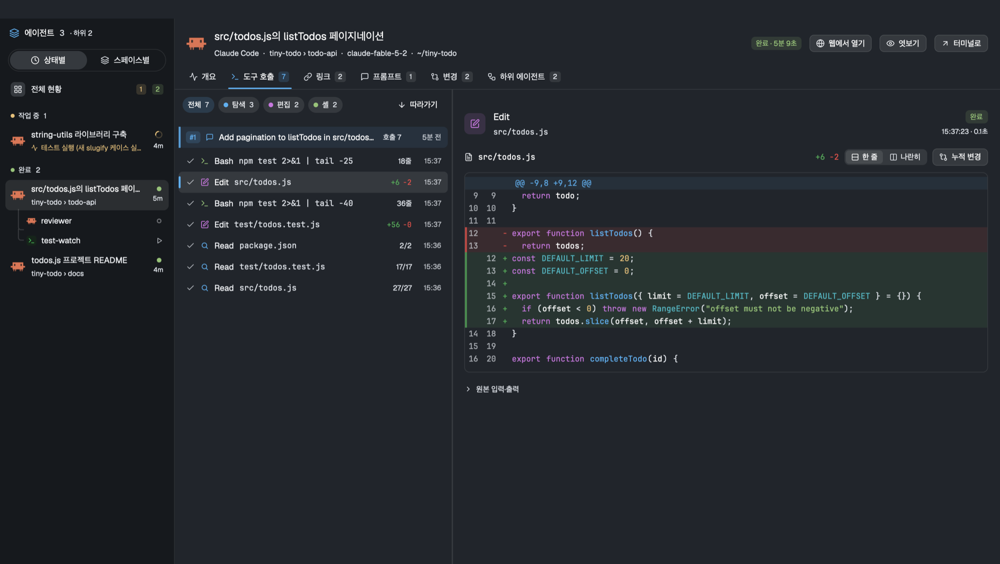
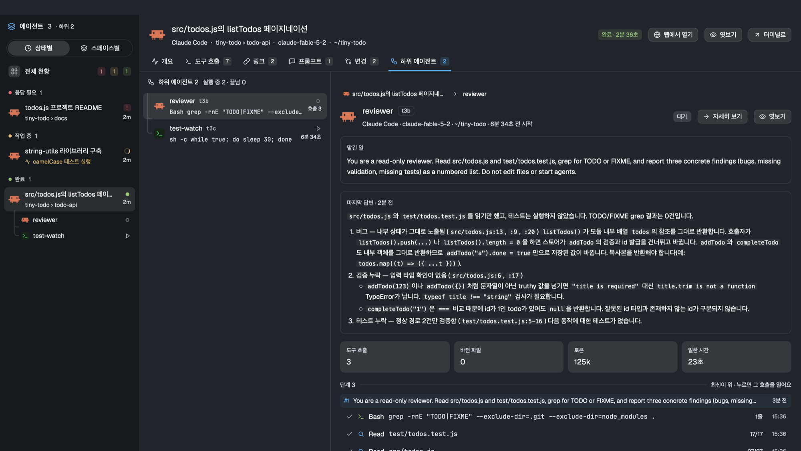
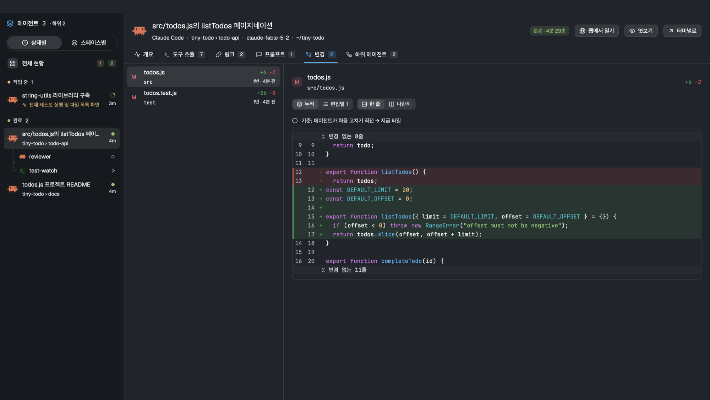
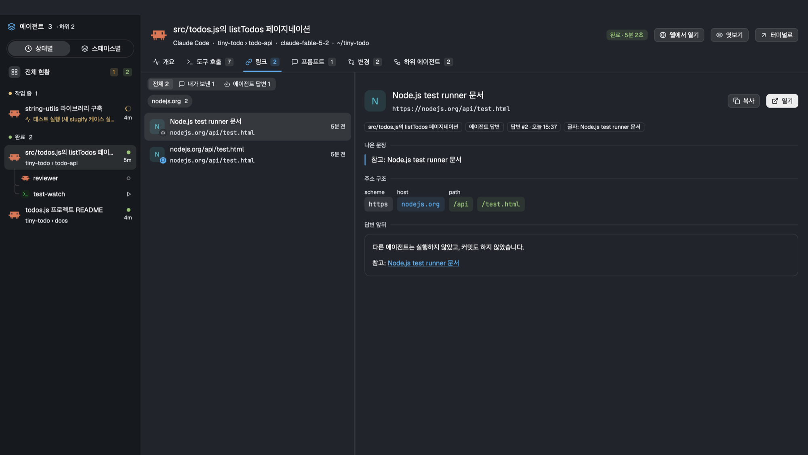
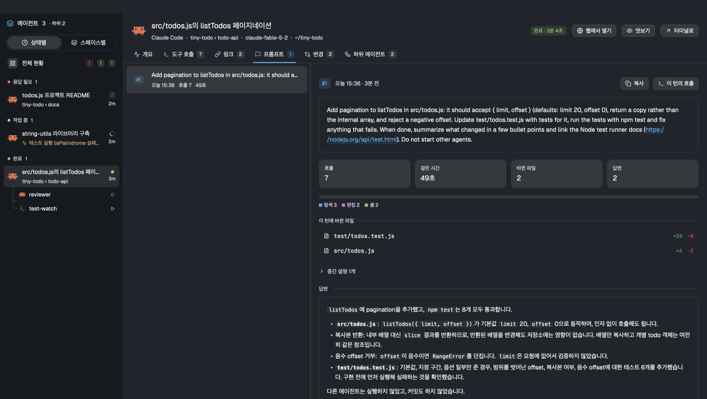

# Agent Dash for the Herdr app

A control room for the coding agents running in Herdr. Press `cmd+shift+a`, pick an agent,
and read what it did. Every tool call gets a view made for that tool, and **Jira, Notion
and Slack MCP calls are drawn the way those sites look**: an issue page, a Notion page, a
Slack thread, instead of a wall of JSON. Gmail, Google Calendar and Google Sheets calls get
the same treatment.



It reads Claude Code and Codex transcripts on this computer. The interface text is Korean.

## MCP calls, drawn like the site

When an agent calls an MCP tool, the result is usually JSON or a long text blob. Agent Dash
parses it and draws it in the product's own light theme. "원본" switches back to the raw
input and output, and a button opens the real page.

| | |
| --- | --- |
|  |  |
|  |  |

| Product | Calls with a view | What it draws |
| --- | --- | --- |
| Jira | `getJiraIssue`, `searchJiraIssuesUsingJql`, `createJiraIssue`, `editJiraIssue`, `transitionJiraIssue`, `addCommentToJiraIssue`, `getTransitionsForJiraIssue` | Breadcrumb, title, status lozenge, the details panel (assignee, reporter, parent, due date, priority, labels), the description and comments as rich text; a work-item table for a JQL search |
| Notion | `notion-fetch`, `notion-search`, `notion-query-data-sources`, `notion-update-page`, `notion-create-pages` | A page with its breadcrumb, icon, properties and blocks (callouts, tables, code, to-dos, quotes); search results; database rows as a table; for writes, what was sent |
| Slack | `slack_read_thread`, `slack_read_channel`, `slack_search_public`, `slack_search_public_and_private`, `slack_send_message` | A thread or channel with authors, times, mentions, links, code and reactions; search results as cards |
| Gmail | `search_threads`, `list_drafts`, `get_thread`, `get_message`, `create_draft`, `update_draft`, `list_labels` | The inbox list (stars, senders, labels, dates, unread in bold), an open conversation, a compose window for a draft. Only the plain-text body is drawn, never the HTML |
| Google Calendar | `list_events`, `search_events`, `get_event`, `create_event`, `update_event`, `delete_event`, `list_calendars`, `suggest_time` | A schedule list grouped by day; an event card with Meet button, place, guests and their replies |
| Google Sheets | `get_values`, `update_values`, `append_values`, `get_spreadsheet`, `batch_clear_values` | A grid with column letters and row numbers that follow the range, the formula bar, sheet tabs; written cells in green |

The MCP servers send no profile pictures, so people are drawn as initials. Other MCP tools
get their arguments as a table and the result as a JSON tree; MongoDB tools get a
Compass-like view. The data in these screenshots is a made-up sample project.

## The lenses

| Lens | What you get |
| --- | --- |
| 개요 (overview) | Tokens, context use, activity by tool kind, changed files, what the agent is doing now, its last reply |
| 도구 호출 (tool calls) | Every call, newest first, grouped under the prompt that caused it. Each tool has its own view: shell output with ANSI colors, diffs for edits, file reads with line ranges, grep and glob results, web fetches, MongoDB queries in a Compass-like view, and Jira, Notion, Slack, Gmail, Google Calendar and Google Sheets results drawn like those sites |
| 링크 (links) | Links from the conversation, split into the ones you sent and the ones the agent wrote, with the sentence around each |
| 프롬프트 (prompts) | What you asked, and for each prompt the calls, time, changed files and the answer |
| 변경 (changes) | Changed files with a cumulative diff (before the agent first touched the file → now) or edit by edit |
| 하위 에이전트 (sub-agents) | The terminals an agent started with `hc run`, as a tree, with each one's task, steps and last reply |

| | |
| --- | --- |
|  |  |
|  |  |
|  |  |

The left rail lists agents by status or by space. A button opens the same view in the
browser.

## Install

Ask your agent in the Herdr app to add this mod from this repo. Or copy it by hand:

1. Copy `mods/agent-dash/` to `~/.config/herdr-app/mods/`.
2. Add the key from `keys.json` to the `global` section of `~/.config/herdr-app/keys.json`
   (keep the commas right; pick another key if `cmd-shift-a` is already taken):

   ```json
   { "global": { "cmd-shift-a": "mod.open:agent-dash" } }
   ```

3. Run `herdr-app check ~/.config/herdr-app/mods/agent-dash`. It should print `check passed`.

The app loads the mod by itself (no restart). Press `cmd+shift+a` to open it, `esc` to close.
It needs `python3` (standard library only) and `hc` (herdr-core) on `PATH`.

**Update:** copy `mods/agent-dash/` over the installed folder again. Your `.me/` picture and the
other folders the mod made stay. The web page's server restarts itself the next time you press
"웹에서 열기".

## Uninstall

1. Stop the web page's server if it is running: `hc kill agent-dash-web`.
2. Remove the key line (`"cmd-shift-a": "mod.open:agent-dash"`) from
   `~/.config/herdr-app/keys.json`.
3. Delete the folder: `rm -rf ~/.config/herdr-app/mods/agent-dash`.

Step 3 also removes everything the mod made (`.cache/`, `.me/`, `.web/`). It writes nothing
outside its own folder, except two small things the app and the browser keep for it:

- The app remembers the rail grouping and the "포커스" switch in
  `~/.config/herdr-app/data/agent-dash/`. To forget them too:
  `rm -rf ~/.config/herdr-app/data/agent-dash`.
- The browser keeps the web page's column widths and a few preferences (at `127.0.0.1`). Clear
  that site's data if you want them gone.

Old `keys.json.bak-*` files the app made still mention the key; they do nothing.

## What it reads and runs

Read this before you install it. The mod works on your conversation history.

- **Reads** Claude Code transcripts in `~/.claude/projects`, session records in
  `~/.claude/sessions`, rewind backups in `~/.claude/file-history`, and Codex rollouts in
  `~/.codex/sessions`. It also reads the files an agent changed, to draw diffs.
- **Runs** `python3` (its own `bin/transcript.py`), `hc ls` / `hc get` to find sub-agents,
  and `git show` for the committed version of a changed file.
- **Writes** only inside its own folder: `.cache/` (copies of images an agent read and of
  pictures you attached to prompts), `.me/` (your avatar) and `.web/` (the web server's port,
  token and the spaces it shows).
- **Network:** the mod makes one request, once: your avatar for the prompt chat view
  (below). The optional local web page loads its fonts from Google Fonts when you open it.
- **Your avatar:** the prompt chat view shows your picture. It is fetched once from GitHub for
  the account this computer is signed in with (the `user:` line of `~/.config/gh/hosts.yml`, a
  GitHub noreply address in `git config user.email`, or `git config github.user`) and kept in
  `.me/` inside the mod folder. To use another picture, put it at `.me/avatar.png` (or `.jpg`,
  `.webp`, `.gif`). To fetch nothing, create an empty `.me/no-avatar` file. Without a picture,
  "나" is drawn. A failed fetch is not retried for a day.
- Secrets in commands and output (tokens, passwords, credential URLs) are masked as `••••`
  before they are drawn. The patterns are in `lib/tools.js`; they are not exhaustive.

### The web page

"웹에서 열기" starts `bin/server.py` as an `hc` terminal named `agent-dash-web` and opens
the page in your browser.

- It listens on `127.0.0.1` only and checks the `Host` header.
- Every start makes a new token; requests without it get 401.
- It serves a file only if that agent's session changed it, and an image only if the
  session read it.
- It exits after 30 minutes without a request. `hc kill agent-dash-web` stops it sooner.

## Supported

- Claude Code and Codex. Other agents appear in the rail but have no transcript view.
- Codex does not publish its session id, so its transcript is matched by folder and start
  time and marked "추정 연결" (inferred).
- Agents on this computer only. Remote machines' agents are listed without their history.
- Tested on macOS only.

## Layout of this repo

- `mods/agent-dash/` is the mod. `lib/` is pure logic shared with the web page, `ui/` draws
  it, `data/` reads transcripts, `bin/` holds the Python helpers and the web server, and
  `web/index.html` is the built web page.
- `web/` is the source of that page. `node web/build.mjs` rebuilds it into the installed
  mod (`~/.config/herdr-app/mods/agent-dash/web/index.html`, or the path in
  `AGENT_DASH_WEB_OUT`).

How it is built, its limits, and checks for a fresh build: [RECIPE.md](RECIPE.md).

## License

MIT. The line icons are from [Lucide](https://lucide.dev) (ISC).
